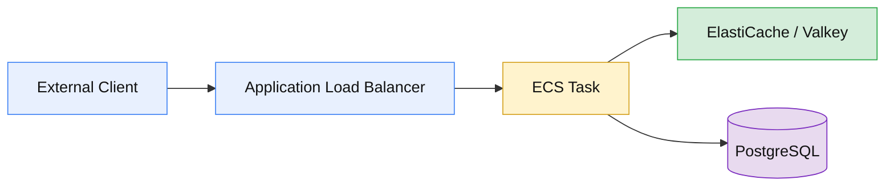

# AWS ECS Proof of Concept

Using this repo as a proving ground for testing various HA/non-HA/sharded deployment configurations for Invar with ECS.

The assumption is that we can use ECS-managed EC2 instances in a family with direct-attached NVMe disks to colocate Invar with the existing workload to eliminate NIC-imposed bandwidth bottlenecks and eliminate network latency + egress costs on lookup.

## Assumed request path

## Alternatives

Depending on your dataset and access pattern you may/may not be SOL. If you want tiered storage but your're not transferring much stuff, ElastiCache Data Tiering or Redis Flex might be acceptable cost and performance-wise. If you _are_ moving a lot of data, you'll eventually hit some infrastructure limits like NIC bandwidth or per-TCP stream limits in AWS. You might find your bill explodes before you hit these limits if your dataset grows first.

There's no deployable 'artifact' for these services you can drop alongside your own workloads, they gate it behind their managed services. Valkey has [this ticket](https://github.com/valkey-io/valkey/issues/83) that's been open for ~2 years now, maybe it lands at some point. Maybe not.

DragonflyDB _does_ support [tiered storage](https://www.dragonflydb.io/docs/managing-dragonfly/tiering) but building the plumbing is still up to you: getting requests to the right instance, handling cluster topology changes, e.t.c. We want to build, support and _own_ that plumbing for users who need it.