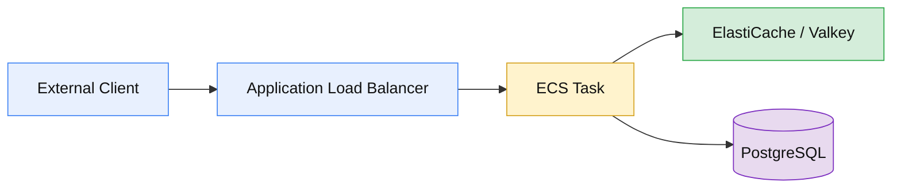

# AWS ECS Proof of Concept

Using this repo as a proving ground for testing various HA/non-HA/sharded deployment configurations for Invar with ECS.

The assumption is that we can use ECS-managed EC2 instances in a family with direct-attached NVMe disks to colocate Invar with the existing workload to eliminate NIC-imposed bandwidth bottlenecks and eliminate network latency + egress costs on lookup.

## Assumed request path

